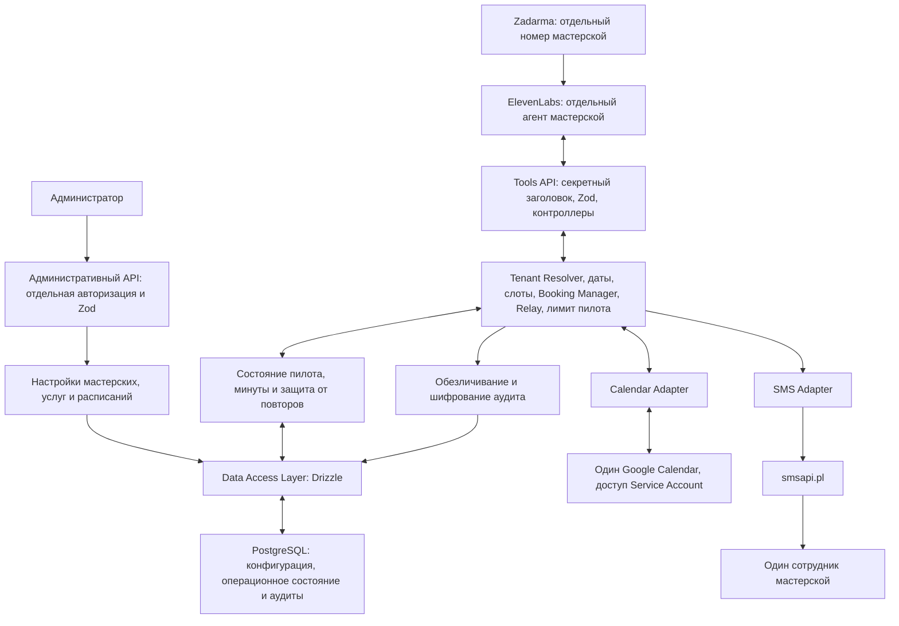
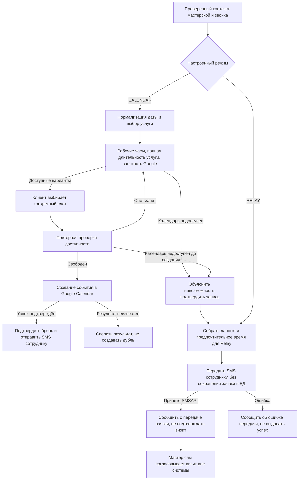

# Схемы архитектуры Gloso

[Исходная диаграмма на Google Drive](https://drive.google.com/drive/folders/1LKuH14ResGCHjUN3hVh29lbtmcfN992X?usp=sharing)

Актуализация локального описания: 19 ноября 2026 г. Этот файл и [`Architecture.md`](Architecture.md) фиксируют согласованный первый этап. Внешний `.drawio` в рамках обновления документации не редактировался. На его первой странице ещё есть исторические Twilio/WhatsApp, 15 секунд и локальный календарь для бумажного учёта — эти элементы не являются текущими требованиями.

## Слои бэкенда

Это логическая схема будущих связей, не подтверждение наличия интеграций. События телефонии и завершения AI-сеанса должны отдельно обеспечивать проверенный контекст и учёт минут; конкретные контракты и корреляция ещё проверяются. Бэкенд не передаёт аудиопоток. Конфигурация, связи с провайдерами, пилот, минуты и минимальные сведения для защиты от повторов хранятся в PostgreSQL. Ретенция 30 дней относится к обезличенным зашифрованным аудитам — см. разделы 9–10 `Architecture.md`.

## Calendar и Relay

- В Relay нет свободных слотов, блокировки времени и теневого календаря. Принятие SMSAPI не равно доставке сотруднику.
- При отказе календаря Relay применяется к текущему обращению, не меняя настройку мастерской. Неопределённый результат создания события сначала сверяется; это не обычный отказ чтения.
- Поля: имя, телефон, марка/модель авто, описание проблемы, предпочтительное время. При скрытом Caller ID допускается продиктованный номер, явно помеченный как непроверенный.
- Неизвестная услуга → диагностика по конфигурации мастерской. Услуги, длительности и рабочие часы пока фиктивные; единого буфера 60 минут нет.
- Данные визита остаются в календаре мастерской, Relay передаётся через SMS. В БД Gloso нет копий заявок, текстов SMS, персональных бронирований, аудио и транскрипций.

## Допуск к AI и границы этапа

До запуска AI проверяются активность 14-дневного пилота и остаток первоначальных 40 минут. После исчерпания новые разговоры блокируются; текущие не прерываются по лимиту. Ожидание перед AI — 10 секунд от начала исходного вызова, с обязательной будущей проверкой на Zadarma/SIP. Счётчик и техническая дедупликация хранятся в PostgreSQL.

Переносы, отмены, SMS-коды, платный биллинг и пакеты отложены. Если позже добавляются изменения визитов, разрешены только события Gloso, не ручные записи мастера.

Сейчас разработка локальная с нуля: PostgreSQL и тестовые адаптеры. Позднее сервер размещается на Northflank, БД — Neon.
